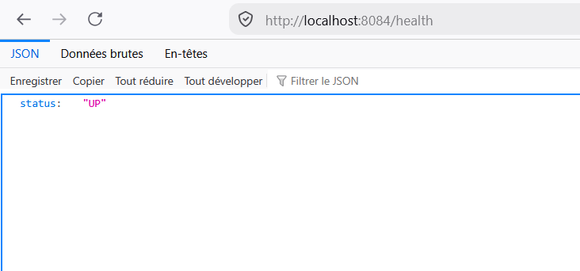
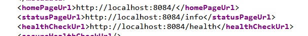

# Atelier Eureka : Architecture Web Distribuée

## Équipe

Molka Kammoun 
Esra Masmoudi
Mohamed Khouni
Nermine Karoui
Samar Masmoudi
Lina Kazdaghli

## Ports

| Service | Technologie | Port(s) | Nom dans Eureka |
|---|---|---|---|
| Eureka Server | Spring Boot | 8761 | - |
| Candidat | Spring Boot | 8088 | CANDIDAT |
| Candidature | Spring Boot | 8089 | CANDIDATURE |
| Job | Spring Boot | 8082 | JOB |
| Meeting | Node.js / Express | 8083, 8093 (2 instances) | MEETING |
| Notification | Python / FastAPI | 8084 | NOTIFICATION |

## Dashboard Eureka


## Tâche 1 : Meeting

Le port est lu depuis la variable d'environnement `PORT` (8083 par défaut).

```powershell
# Instance 1
node src/server.js

# Instance 2
$env:PORT=8093; node src/server.js
```


### Plusieurs instances de Meeting

Les deux instances (`meeting:8083` et `meeting:8093`) sont enregistrées sous le même nom MEETING : le dashboard affiche `UP (2)`.


## Tâche 2 : Notification




### Registre Eureka



