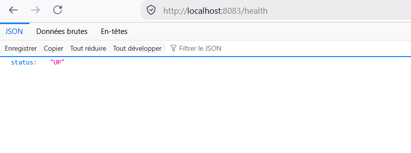
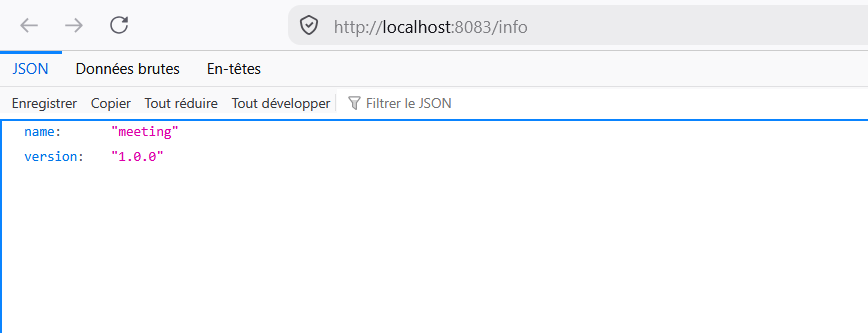
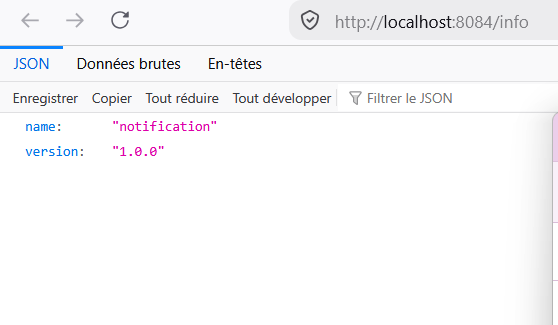
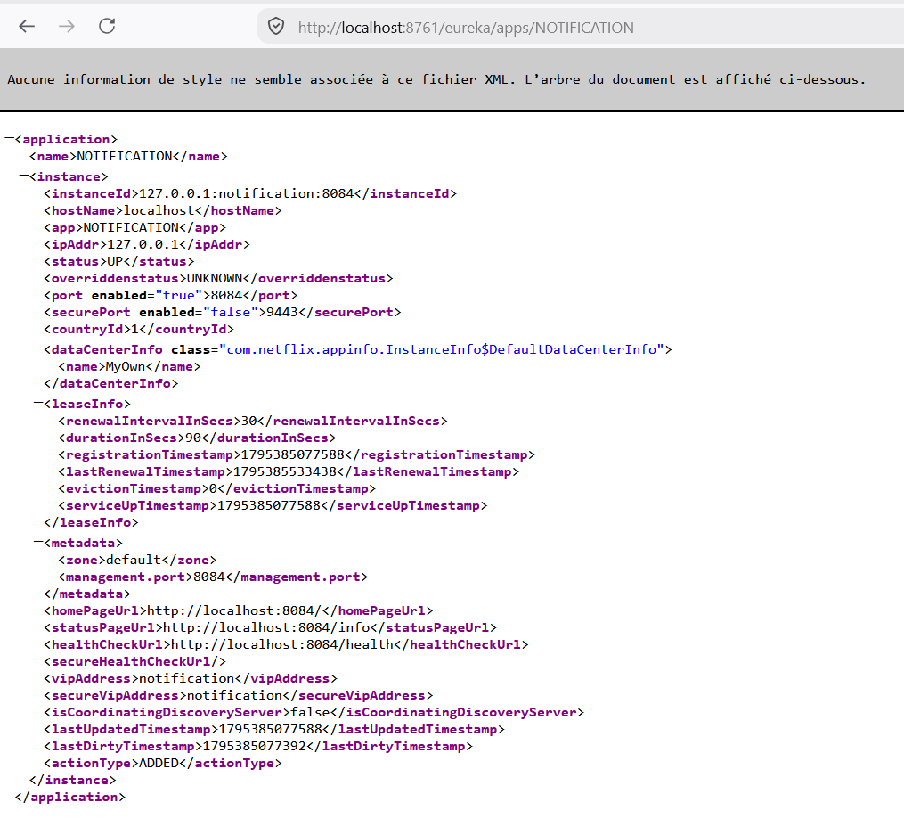

# Atelier Eureka : Architecture Web Distribuée

## Équipe

- Molka Kammoun
- Esra Masmoudi
- Mohamed Khouni
- Nermine Karoui
- Samar Masmoudi
- Lina Kazdaghli

## Ports

| Service | Technologie | Port(s) | Nom dans Eureka |
|---|---|---|---|
| Eureka Server | Spring Boot | 8761 | - |
| Candidat | Spring Boot | 8088 | CANDIDAT |
| Candidature | Spring Boot | 8089 | CANDIDATURE |
| Job | Spring Boot | 8082 | JOB |
| Meeting | Node.js / Express | 8083, 8093 (2 instances) | MEETING |
| Notification | Python / FastAPI | 8084 | NOTIFICATION |

## Dashboard Eureka

### Vue d'ensemble des services enregistrés

## Tâche 1 : Microservice Meeting

### Vérifier le health du microservice Meeting

### Vérifier les informations du microservice Meeting

### Plusieurs instances de Meeting

Les deux instances (`meeting:8083` et `meeting:8093`) sont enregistrées sous le même nom MEETING : le dashboard affiche `UP (2)`.

## Tâche 2 : Microservice Notification 

### Vérifier le health du microservice Notification

### Vérifier les informations du microservice Notification

### Enregistrement dans Eureka

#### Notification dans le registre Eureka

#### statusPageUrl et healthCheckUrl de Notification

