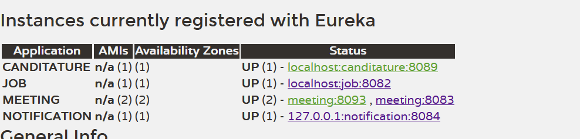

# Atelier Eureka : Architecture Web Distribuée

Microservices enregistrés dans un serveur **Eureka**, chacun avec des routes `/health` et `/info` déclarées via `healthCheckUrl` et `statusPageUrl`.

## Ports

| Service | Technologie | Port |
|---|---|---|
| Eureka Server | Spring Boot | 8761 |
| Candidat | Spring Boot | 8088 |
| Candidature | Spring Boot | 8089 |
| Job | Spring Boot | 8082 |
| Meeting | Node.js / Express | 8083 |
| Notification | Python / FastAPI | 8084 |

## Dashboard Eureka

Les cinq microservices sont enregistrés et **UP** (`http://localhost:8761`).

## Tâche 1 : Meeting (Node.js / Express)

Routes `/health` et `/info` dans `src/app.js` (avant le handler 404), et URLs déclarées dans `src/server.js`.

| `GET /health` | `GET /info` |
|---|---|
|  |  |

## Tâche 2 : Notification (Python / FastAPI)

Routes `/health` et `/info` dans `app/main.py`, et paramètres `health_check_url` et `status_page_url` dans `eureka_client.init_async(...)`.

| `GET /health` | `GET /info` |
|---|---|
|  |  |

### Vérification dans le registre

`GET http://localhost:8761/eureka/apps/NOTIFICATION`

Les deux URLs sont bien enregistrées :

